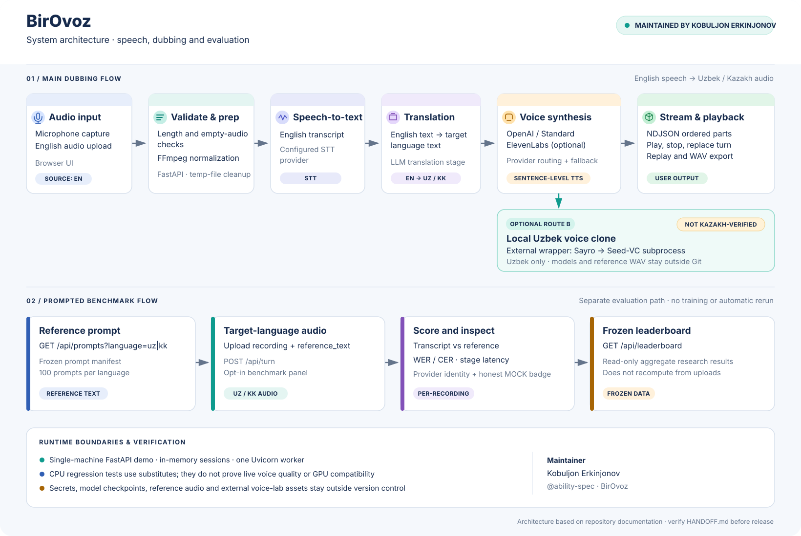

# BirOvoz Architecture

**Maintainer:** [Kobuljon Erkinjonov](https://github.com/ability-spec)  
**Repository:** [ability-spec/central-asian-voice-benchmark](https://github.com/ability-spec/central-asian-voice-benchmark)

BirOvoz is a single-machine voice demo and research benchmark for English-to-Uzbek/Kazakh dubbing. This page documents the implemented product boundaries, provider paths, and the separate evaluation workflow.

## 1. Main dubbing flow

The normal product flow starts with English speech and ends with generated Uzbek or Kazakh audio:

1. **Capture or upload.** The browser records microphone audio or accepts an English audio file.
2. **Validate and prepare.** The FastAPI backend checks input constraints, rejects empty or overlong audio, normalizes supported audio through FFmpeg when needed, and manages request-scoped temporary files.
3. **Speech recognition.** The configured speech provider transcribes the English input.
4. **Translation.** The text is translated to the selected target language.
5. **Speech synthesis.** Sentence-level TTS produces ordered audio parts. OpenAI/Standard is the default and fallback path; ElevenLabs is an optional independent provider. The optional local voice-clone route is only enabled when configured.
6. **Stream and play.** `POST /api/turn/stream` sends NDJSON events (`meta`, `part`, `done`, `error`) so the browser can play ordered audio parts, stop or replace a turn, and recover from failures. Completed dubs can be replayed and exported as WAV.

The browser UI is served by the FastAPI application. The primary implementation lives in `product/backend/` and `product/frontend/index.html`.

## 2. Speech synthesis provider paths

- **OpenAI/Standard:** default synthesis and runtime fallback for a local-clone failure, missing configuration, timeout, or unsupported language.
- **ElevenLabs:** an optional voice provider with a separate consent-gated enrollment path. It does not depend on the local clone.
- **Local Uzbek voice clone (Route B):** BirOvoz invokes the existing external voice-lab wrapper, which runs Sayro followed by Seed-VC. The integration uses the wrapper's documented CLI rather than copying the external model implementation into this repository. Model checkpoints, voice references, and external project paths remain outside this repository.
- **Kazakh local clone:** not supported in the current MVP. Kazakh continues through the standard provider path; do not interpret a local-clone UI choice as evidence of Kazakh clone support.

The local Route B integration is owner-reported from the Windows/NVIDIA environment. Automated CPU tests use provider/model substitutes and do not establish real GPU compatibility or voice quality.

## 3. Separate prompted benchmark flow

The benchmark panel evaluates a target-language recording against a frozen reference prompt. It is intentionally separate from ordinary dubbing so the UI does not accidentally send reference text with a normal microphone turn.

1. `GET /api/prompts?language=uz|kk` returns the frozen prompts in manifest order.
2. The user records or uploads the target-language speech and submits it to `POST /api/turn` with `reference_text`.
3. The response provides the recognized transcript, reference comparison, WER/CER, stage latency, provider identity, and an honest `MOCK` marker when deterministic mock mode is active.
4. `GET /api/leaderboard` serves frozen aggregate research results. It does not re-score uploads or rerun the research benchmark.

WER/CER from mock-provider runs are not real speech-recognition accuracy measurements. Frozen research scores and interactive demo measurements must remain distinct.

## 4. Runtime and deployment boundary

- **Application:** FastAPI backend and static browser UI.
- **API contracts:** `POST /api/turn`, `POST /api/turn/stream`, `GET /api/prompts`, and `GET /api/leaderboard`.
- **Session state:** in memory, intended for a single-machine demo with one Uvicorn worker.
- **Default binding:** `127.0.0.1`. Bind to `0.0.0.0` only on a trusted network and with deployment risks understood.
- **Configuration:** local `.env` values and provider/model settings. Real secrets must never be committed.
- **External assets:** voice-clone checkpoints, reference WAVs, voice-lab and Seed-VC directories must stay outside version control.

This is not a public multi-tenant production service. Authentication, durable session storage, queue infrastructure, model training, and dataset training are outside the current MVP scope.

## 5. Verification status

| Area | What current evidence means |
| --- | --- |
| API, UI logic, streaming lifecycle and regressions | Automated CPU/Node tests with provider/model substitutes |
| Mock-mode API + FFmpeg paths | Exercised in automated tests |
| Live cloud-provider speech quality | Requires valid credentials and real end-to-end acceptance |
| Windows/NVIDIA local voice clone | Requires manual acceptance with actual checkpoints and reference audio |
| Real browser microphone, autoplay, cancellation and WAV export | Requires manual browser acceptance |
| Kazakh local voice clone | Not implemented/verified |

For the latest pass/fail counts and release checklist, use [HANDOFF.md](../HANDOFF.md) and [MVP_ACCEPTANCE.md](../MVP_ACCEPTANCE.md). Test counts can change as commits land; the diagram deliberately avoids treating a test count as a release guarantee.

## Maintainer

Architecture documentation and product integration maintained by **Kobuljon Erkinjonov** ([`ability-spec`](https://github.com/ability-spec)).
